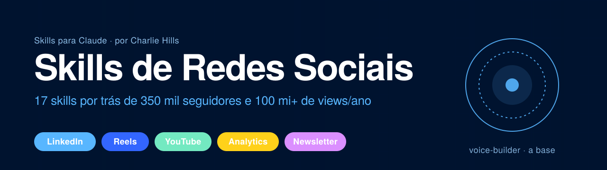

<p align="center">
  
</p>

# Skills de Redes Sociais para Agentes de IA (versão em português)

Tradução para o português do Brasil do plugin [charlie947/social-media-skills](https://github.com/charlie947/social-media-skills) (licença MIT), criado por [Charlie Hills](https://charliehills.substack.com). Os nomes das skills e das pastas continuam em inglês para manter a compatibilidade com o plugin original; todo o conteúdo, as perguntas, os modelos e os prompts estão em português.

São 17 skills públicas e independentes para **Codex e Claude**: voz da pessoa, escrita para LinkedIn, pesquisa, analytics, roteiro de Reels e prompts de imagem para o Gemini. Este repositório é um kit público de ferramentas, não o sistema privado completo de LinkedIn com IA do autor, seu fluxo de produção no Figma ou as contas e configurações dele.

Assine a [newsletter MarTech AI](https://charliehills.substack.com) do autor original para análises semanais de como este sistema funciona na prática.

## O que são skills?

Skills são arquivos markdown que dão aos agentes de IA conhecimento e fluxos de trabalho especializados para tarefas específicas. Quando você as instala no seu projeto, o assistente reconhece quando você está trabalhando em uma tarefa de redes sociais e aplica os padrões, as regras de voz e as restrições de cada plataforma.

## Como as skills trabalham juntas

Use o `voice-builder` para criar `about-me.md` e `voice.md` no projeto escolhido. As skills leem esse contexto antes de qualquer trabalho personalizado. Arquivos já existentes e aprovados pelo autor também servem. Perfis ausentes ou com valores iniciais de exemplo precisam ser resolvidos antes de afirmar que o texto segue a voz. Pesquisa e analytics baseados só em fontes podem rodar sem um perfil de voz pessoal. O `newsletter-voice` é opcional, para trabalho com newsletter.

```
                    ┌──────────────────────────────────────┐
                    │           voice-builder              │
                    │   about-me.md + voice.md             │
                    │   (lido por todas as skills abaixo)  │
                    └──────────────────┬───────────────────┘
                                       │
                    ┌──────────────────▼───────────────────┐
                    │         newsletter-voice             │
                    │   newsletter-voice.md                │
                    │   (contexto opcional de newsletter)  │
                    └──────────────────┬───────────────────┘
                                       │
     ┌────────────┬────────────┬───────┴───────┬────────────┬────────────┐
     ▼            ▼            ▼               ▼            ▼            ▼
┌──────────┐ ┌──────────┐ ┌──────────┐ ┌──────────────┐ ┌──────────┐ ┌──────────┐
│ Perfil   │ │ Posts de │ │ Vídeo    │ │ Analytics e  │ │Comunidade│ │Avulsas   │
│          │ │ LinkedIn │ │          │ │ Avaliação    │ │          │ │          │
├──────────┤ ├──────────┤ ├──────────┤ ├──────────────┤ ├──────────┤ ├──────────┤
│profile-  │ │post-     │ │reels-    │ │post-scorer   │ │pinned-   │ │hook-gen  │
│ optimizer│ │ writer   │ │ scripting│ │              │ │ comment  │ │content-  │
│          │ │graphic-  │ │youtube-  │ │analytics-    │ │          │ │ matrix   │
│          │ │ designer │ │ thumbnail│ │ dashboard    │ │          │ │niche-    │
│          │ │          │ │          │ │              │ │          │ │ research │
│          │ │post-form │ │          │ │              │ │          │ │gemini-*  │
│          │ │          │ │          │ │              │ │          │ │quote-post│
└──────────┘ └──────────┘ └──────────┘ └──────────────┘ └──────────┘ └──────────┘
```

Veja o `SKILL.md` de cada skill para as frases de acionamento, as entradas e as dependências.

## Skills disponíveis

<!-- SKILLS:START -->
| Skill | Descrição |
|---|---|
| [voice-builder](skills/voice-builder/) | Cria `about-me.md` e `voice.md` a partir de uma entrevista e de 3 a 5 textos de amostra. A base que todas as outras skills leem. |
| [newsletter-voice](skills/newsletter-voice/) | Acrescenta instruções de escrita específicas para newsletter em cima do voice-builder. Gera `newsletter-voice.md`. |
| [profile-optimizer](skills/profile-optimizer/) | Reconstrói o perfil do LinkedIn para converter. Título, Sobre, Experiência, seção Em Destaque e 4 prompts de geração de imagem. |
| [post-writer](skills/post-writer/) | Redige posts de LinkedIn na sua voz usando os arquivos de voz. |
| [graphic-designer](skills/graphic-designer/) | Cria HTML/CSS mais um PNG inspecionado quando há renderização disponível, ou um prompt de imagem para o Gemini. |
| [post-scorer](skills/post-scorer/) | Avalia com base no histórico que você fornecer ou em resultados autorizados do Apify, com alternativa apenas editorial. |
| [reels-scripting](skills/reels-scripting/) | Analisa um Reel de referência via Apify + Gemini 2.5 Flash, ou usa o material fornecido. Redige e revisa um roteiro na sua voz. |
| [youtube-thumbnail](skills/youtube-thumbnail/) | Transforma o título de um vídeo em um prompt de thumbnail de YouTube com a sua marca, para o Gemini. |
| [pinned-comment](skills/pinned-comment/) | Comentários fixados no estilo meme com o prompt de geração de imagem correspondente. |
| [hook-generator](skills/hook-generator/) | 6 ângulos de gancho concisos usando fatos fornecidos e experiência real do autor. |
| [post-formatter](skills/post-formatter/) | Do tema ao post pronto para publicar usando PAS, AIDA, BAB, STAR ou SLAY. |
| [content-matrix](skills/content-matrix/) | Combina seus 3 a 5 pilares com 8 formatos para gerar de 24 a 40 ideias de post. |
| [niche-research](skills/niche-research/) | Encontra até 20 histórias datadas dos últimos 7 dias com as ferramentas de web e navegador disponíveis e cobertura de fontes explícita. |
| [gemini-infographic](skills/gemini-infographic/) | Cria um briefing de infográfico de quadro branco e o prompt para o Gemini. |
| [gemini-carousel](skills/gemini-carousel/) | Cria um briefing de carrossel e prompts do Gemini por slide, com etapa de aprovação. |
| [quote-post](skills/quote-post/) | Redige frases originais e um prompt do Gemini no estilo de referência escolhido. |
| [analytics-dashboard](skills/analytics-dashboard/) | Da exportação do LinkedIn Analytics a um dashboard React interativo, mais 5 recomendações sustentadas por dados. |
<!-- SKILLS:END -->

## Instalação

### Claude Code: marketplace de plugins

Este repositório tem um marketplace na raiz (`.claude-plugin/marketplace.json`) que aponta para esta pasta. No Claude Code:

```text
/plugin marketplace add thata0795-bit/Briefing-Auri
/plugin install social-media-skills-pt@briefing-auri
```

Para atualizar, use o mecanismo de atualização de plugins que o Claude Code já tem.

### Claude Code: cópia local no projeto

Sem usar o comando `/plugin`, copie as skills para `.claude/skills/` do projeto em que você vai trabalhar. Rode a partir da raiz desse projeto, com esta pasta `social-media-skills` dentro dele:

```bash
mkdir -p .claude/skills && for skill in social-media-skills/skills/*; do
  name="$(basename "$skill")"
  [ -e ".claude/skills/$name" ] && printf 'Skill existente preservada: %s\n' "$name" || cp -R "$skill" ".claude/skills/$name"
done
```

### Codex: cópia local no projeto

A partir da raiz do projeto escolhido, com esta pasta `social-media-skills` dentro dele, copie cada skill para o caminho de descoberta do Codex. Se a pasta já existir, inspecione e reaproveite em vez de sobrescrever.

<!-- CODEX-COPY:START -->
```bash
test -d social-media-skills/skills || { printf 'Pasta de skills de origem ausente\n'; exit 1; }
mkdir -p .agents/skills || exit 1
for skill in social-media-skills/skills/*; do
  [ -f "$skill/SKILL.md" ] || continue
  name="$(basename "$skill")"
  destination=".agents/skills/$name"
  if [ -e "$destination" ] || [ -L "$destination" ]; then
    printf 'Skill existente preservada: %s\n' "$destination"
  else
    cp -R "$skill" "$destination" || exit 1
  fi
done
```
<!-- CODEX-COPY:END -->

Abra uma tarefa nova do Codex neste projeto e confirme que as skills desejadas são carregadas de `.agents/skills/<nome>/SKILL.md`. Um clone ou submódulo em `.agents/social-media-skills` sozinho não é o caminho de descoberta documentado. Evite instalar uma segunda versão conflitante no modo global e no local.

### Claude Desktop: envio de skills individuais

Compacte a pasta inteira de uma skill, incluindo a `references/` quando existir, e envie em Personalizar skills. Por exemplo, a partir de `social-media-skills/skills`:

```bash
zip -r voice-builder.skill voice-builder
```

Esses envios contêm só a skill pública escolhida. Instale outra skill quando um fluxo citar o nome dela, ou peça ao assistente para fazer o próximo passo diretamente com o contexto fornecido.

### Atualizando uma cópia instalada

Atualize a origem pelo Git normal (`git pull --ff-only` depois de conferir as alterações locais). Skills copiadas ou enviadas não se atualizam quando a origem muda. Confira o caminho que está de fato carregado e compare a pasta instalada com a nova origem. Preserve arquivos personalizados, mescle as mudanças relevantes e recarregue em uma tarefa nova. O laço de cópia acima preserva de propósito as pastas existentes, inclusive links simbólicos; ele não é um atualizador. Se o caminho carregado for um link simbólico, confira a origem resolvida e atualize essa origem pelo caminho Git dela. Nunca substitua às cegas uma instalação personalizada.

## Uso

Para escrita personalizada, rode primeiro o `voice-builder` ou forneça seu perfil de autor existente. Mantenha esses arquivos no projeto de conteúdo, não dentro da pasta de uma skill instalada.

Depois de instalar, peça ao Codex ou ao Claude ajuda com tarefas de conteúdo e ele escolhe a skill certa:

```
"Construa minha voz" → voice-builder
"Escreva um post sobre agentes de IA" → post-writer
"Avalie este rascunho com base no meu histórico" → post-scorer
"Faça um carrossel com isto" → gemini-carousel
"Sobre o que eu posto esta semana" → niche-research ou content-matrix
"Transforme este Reel fora da curva em roteiro" → reels-scripting
"Preciso de uma thumbnail para 'Como eu demiti meu time'" → youtube-thumbnail
"Escreva um comentário fixado" → pinned-comment
```

## Categorias de skills

### Base de voz
- `voice-builder`: entrevista + análise de amostras, gera about-me.md e voice.md
- `newsletter-voice`: regras de escrita específicas de newsletter em cima do voice-builder

### LinkedIn
- `profile-optimizer`: reconstrução completa do perfil
- `post-writer`: rascunhos na sua voz
- `graphic-designer`: exportação em HTML/CSS ou prompt do Gemini, conforme o caminho escolhido
- `post-formatter`: do tema ao post com um framework nomeado (PAS, AIDA, BAB, STAR, SLAY)
- `hook-generator`: 6 variações de gancho por tema
- `post-scorer`: avalia rascunhos com base no seu histórico de posts
- `content-matrix`: ideação cruzando pilares e formatos
- `niche-research`: pesquisa dos últimos 7 dias com as ferramentas de fonte disponíveis
- `gemini-infographic`: estilo quadro branco para o Gemini
- `gemini-carousel`: carrossel slide por slide
- `quote-post`: fluxo de frase em duas etapas

### Reels do Instagram
- `reels-scripting`: análise de referência com Apify + Gemini 2.5 Flash, roteiro alinhado à newsletter

### YouTube
- `youtube-thumbnail`: do título ao prompt de thumbnail no Gemini

### Comunidade
- `pinned-comment`: comentário fixado estilo meme + prompt de imagem

### Analytics
- `analytics-dashboard`: da exportação do LinkedIn ao dashboard + 5 recomendações

## Capacidades e estados de conclusão

Conecte apenas as integrações necessárias para o fluxo escolhido. Credenciais ficam na sua conta ou no seu ambiente local, nunca neste repositório nem nas respostas do chat. Conexões existentes devem ser preservadas.

| Fluxo | Capacidade necessária | Se não estiver disponível |
|---|---|---|
| Voz, posts, ganchos, formatação, matriz | Contexto fornecido e amostras de texto para trabalho personalizado | Pedir os fatos que faltam; nunca usar os padrões do mantenedor |
| Pesquisa de nicho | Acesso atual a fontes via busca na web ou navegador | Fontes datadas fornecidas ou estado de pesquisa pendente; resultados indexados não são uma varredura completa de feed |
| Avaliador de posts | Histórico de posts fornecido; Apify é opcional para uma busca pedida | Revisão apenas editorial, com a comparação de histórico indisponível |
| Análise de Reel por URL | Acesso autorizado ao Apify (`APIFY_API_TOKEN`), acesso ao Gemini 2.5 Flash (`GOOGLE_AI_API_KEY`), Node e os SDKs citados | Vídeo fornecido pode pular o Apify; transcrição fornecida permite um roteiro sinalizado como baseado em transcrição |
| Skills visuais do Gemini | Nenhuma integração para redigir prompts; acesso a imagens do Gemini para gerá-las | Só o prompt pronto, com geração e inspeção de imagem pendentes |
| Arte em HTML | Screenshot ou exportação pelo navegador, ou um renderizador existente | HTML editável com renderização e inspeção pendentes |
| Analytics | Exportação da pessoa e leitor de planilhas; ambiente React/Recharts para pré-visualização interativa | Análise calculada e código-fonte, com pré-visualização interativa pendente |

As skills de imagem mantêm seus contratos de prompt para o Gemini. Elas não incluem um sistema de produção no Figma nem capas de carrossel animadas. O `graphic-designer` também gera HTML editável. Imagens de fato renderizadas devem ser abertas e inspecionadas em tamanho real e em tamanho de feed antes de serem chamadas de revisadas visualmente. Em um carrossel, inspecione cada slide. Um prompt, uma conta conectada ou uma verificação estática aprovada não são essa prova.

O Codex faz a redação e a revisão por conta própria; o Claude é opcional em uma tarefa do Codex. A coleta de dados se limita ao texto original dos posts e às contagens agregadas. Nunca colete comentários ou respostas, nem ative a coleta de comentários de forma indireta. Salvar um rascunho não o publica.

## Contribuindo

Veja o [CONTRIBUTING.md](CONTRIBUTING.md) com as diretrizes para adicionar ou melhorar skills. Melhorias no conteúdo original devem ser propostas no [repositório do autor](https://github.com/charlie947/social-media-skills).

Rode `bash validate-skills.sh` e `python3 tests/test-codex-portability.py` antes de enviar. Acrescente `--codex` à verificação em Python no macOS/Linux para conferir a descoberta por um Codex CLI instalado, em um HOME temporário vazio, sem credenciais. Essas verificações conferem a estrutura das skills, a preservação na instalação e os contratos de instrução. Elas não certificam um provedor ao vivo, o desempenho do modelo, a qualidade visual nem o ambiente ativado da pessoa.

## Licença

[MIT](LICENSE). Use como quiser. Se ajudarem você, um link para a [newsletter](https://charliehills.substack.com) do autor original é bem-vindo.
